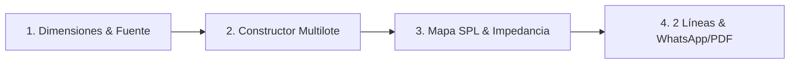

# MANUAL DE USUARIO DEL SOFTWARE: STAGE PLAN (v4.0)
**Sistema Web Responsivo de Planificación Logística, Constructor Híbrido Multilote, Impedancia Speakon y Seguridad SEC para Eventos en Formato DJ**  
**Proyecto de Título / Integrado: Analista Programador — INACAP**  
**Versión del Sistema:** 4.0.0  
**Fecha de Emisión:** Noviembre 2026  

---

## 1. INTRODUCCIÓN Y PROPÓSITO DEL SISTEMA

**STAGE PLAN (v4.0)** es una herramienta de ingeniería y logística para **pre-producción** de eventos en formato DJ. Su propósito principal es sustituir el cálculo empírico ("a ojo") por formulación técnica rigurosa basada en la **Normativa Eléctrica Chilena de la SEC (Pliegos RIC N° 03 y RIC N° 10)**, principios de electroacústica, ley de Ohm para impedancia acústica y dimensionamiento de cableado.

### Enfoque Operativo "Online-First + Reporte Autónomo":
1. **En la oficina / hogar (con internet):** El operador ingresa las medidas del salón, configura sus equipos mediante el **Constructor Híbrido Multilote** (cajas activas y pasivas con Watts RMS y Peak), visualiza el semáforo de carga, el cálculo de impedancia Speakon, la división en **2 Líneas de Fuerza Eléctrica** y el **Mapa de Calor SPL 2D**.
2. **Exportación Inmediata:** Con un solo clic copia un resumen técnico directo a **WhatsApp** y genera la **Ficha Técnica en PDF descargable** en el navegador.
3. **En terreno / parcela (sin señal móvil):** El técnico abre el archivo PDF descargado en su smartphone. El documento contiene el inventario, calibres de cables, división de líneas, retardos Haas, recomendaciones de ganancia DJM y advertencias normativas.

---

## 2. REQUISITOS DEL SISTEMA Y PUESTA EN MARCHA

### 2.1 Requisitos Mínimos de Hardware y Software
- **Dispositivos soportados:** Computadores de escritorio, laptops, tablets y smartphones (diseño responsivo Mobile-First a partir de 360 px de ancho con paleta *Hard Techno Industrial* de alto contraste).
- **Navegadores web recomendados:** Google Chrome (versión 110+), Mozilla Firefox (versión 110+), Safari (versión 16+), Microsoft Edge (versión 110+).
- **Lector de PDF:** Cualquier visor estándar (Adobe Reader, visores nativos de Android / iOS).

### 2.2 Inicio de la Aplicación en Modo Local

```powershell
# 1. Abrir terminal en la raíz del proyecto
cd "c:\Users\WIT2026\Documents\Proyecto Integrado"

# 2. Ejecutar las pruebas unitarias automatizadas (70 tests Vitest)
npm run test

# 3. Iniciar el Frontend (Panel de Control de Usuario)
npm run dev
```
Abre en tu navegador la dirección indicada: `http://localhost:5173`.

---

## 3. GUÍA PASO A PASO: FLUJO DE TRABAJO DEL OPERADOR



---

### PASO 1: Dimensionamiento del Recinto y Fuente de Energía

En la sección **"Paso 1: Recinto & Fuente Eléctrica"**, ingresa los datos geométricos del evento:

1. **Nombre Recinto:** Identificador del salón o parcela (ej. *Parcela Los Aromos, Curacaví*).
2. **Ancho (m), Profundidad (m) y Altura (m):** Dimensiones del área útil del público y pista de baile. El sistema calcula automáticamente la superficie en $\text{m}^2$ y el volumen en $\text{m}^3$.
3. **Tipo de Recinto:** 
   - `Cerrado (Salón)`: Aplica fórmulas de acústica de salas (Sabine $RT_{60}$ y campo reverberante Hopkins-Stryker).
   - `Abierto (Parcela/Exterior)`: Aplica la ley del inverso del cuadrado en campo libre.
4. **Distancia al Tablero (m):** Metros lineales desde la posición de la cabina DJ hasta el enchufe o generador.
5. **Fuente de Alimentación Eléctrica:**
   - **Enchufe de Red 220V:** Selecciona la capacidad del automático (`10 A`, `16 A`, `20 A`, `25 A`).
   - **Generador Portátil:** Ingresa los Watts o kVA comerciales. El sistema aplica el factor de seguridad del **72% AVR** para salvaguardar los amplificadores de caídas de voltaje.

---

### PASO 2: Constructor Híbrido Multilote (Audio, Iluminación y Mixer)

En la sección **"Paso 2: Constructor de Equipos Multilote"**:

#### A. Cajas Acústicas (Tops) — Multilote Activo / Pasivo
Permite ingresar múltiples lotes de cajas diferentes. Por ejemplo:
- **Lote 1:** 2 cajas Activas de 500W RMS / 1000W Peak (Frente estéreo).
- **Lote 2:** 1 caja Pasiva de 300W RMS / 600W Peak @ 8 Ohms (Torre de delay).
- Presiona `[+ Agregar Lote de Cajas]` o el botón rápido `[⚡ Ejemplo: 2 Activas + 1 Pasiva]`.
- El algoritmo **Asymmetric Rigging** ubica las 2 cajas más potentes al frente (`A, B` a 0 dB) y la 3ª caja a delay con **Gain Matching (-2.2 dB)** para protegerla de saturación.

#### B. Sub-Bajos (Subs) — Multilote Activo / Pasivo
- Ingresa lotes de subwoofers con su potencia RMS, Peak e impedancia en Ohms.
- **Regla Estructural Obligatoria:** Todos los subwoofers se posicionan agrupados en el suelo al centro (**Mono Cluster Central** a $<1.7\text{ m}$) para ganar $+6\text{ dB}$ gratis por acoplamiento mutuo, prohibiendo el uso de tubos pole mount.

#### C. Asistente de Impedancia Speakon en Paralelo
Si ingresas cajas pasivas puenteadas:
- Calcula la resistencia equivalente ($1/Z_{eq} = 1/Z_1 + 1/Z_2 + \dots$).
- Si la impedancia cae bajo **$3.2\ \Omega$**, el sistema activa una **Alerta Roja PROTECT** advirtiendo que el amplificador colapsará por sobrecorriente.

---

### PASO 3: Mapa de Calor SPL 2D y Diagnósticos Acústicos

Presiona el botón interactivo **`[🔥 Ver Mapa de Calor SPL]`** en el plano 2D:
- **Rojo Intenso (>105 dBA):** Zona de alta presión sonora frente al escenario.
- **Verde Esmeralda (96-102 dBA):** Zona de confort acústico (*Sweet Spot* de pista).
- **Azul (<90 dBA):** Caída sonora al fondo del recinto.
- **Auditoría de Balance Top/Sub:** Informa si existe déficit de subgraves o si el sistema está equilibrado.

---

### PASO 4: División en 2 Líneas Eléctricas, WhatsApp y PDF

En el Paso 4:
1. **División en 2 Líneas de Fuerza:**
   - **Línea 1 (Sub-Bajos):** Amperaje y Watts dedicados para los transitorios del bombo.
   - **Línea 2 (Tops + Cabina DJ):** Amperaje y Watts dedicados para agudos y mixer, blindando la música de reinicios.
2. **Copiar Resumen para WhatsApp:** Presiona `[💬 Copiar Resumen WhatsApp]` para pegar en el grupo del equipo técnico la ficha clave (potencias, impedancias, cables, calibres y retardos).
3. **Descargar Ficha Técnica PDF:** Presiona `[📄 Descargar Ficha Técnica PDF]` para obtener el documento oficial de 5 páginas listo para operar en terreno sin internet.

---

## 4. MATRIZ DE SOLUCIÓN RÁPIDA

| Síntoma en Terreno | Diagnóstico de STAGE PLAN | Acción Correctiva Inmediata |
|---|---|---|
| *El amplificador pasivo entra en modo PROTECT.* | Impedancia Speakon menor a $3.2\ \Omega$ por exceso de cajas en paralelo. | Separar cajas en canales estéreo independientes (mínimo $4\ \Omega$). |
| *La 3ª caja suena distorsionada respecto al frente.* | Desbalance de potencia por mezclar cajas activas y pasivas desiguales. | Aplicar el valor de **Gain Matching** calculado en dB a la caja de delay. |
| *El generador se apaga en cada drop de Techno.* | Sobrecarga del regulador AVR por conectar subs y tops a una sola línea. | Dividir en **2 Líneas de Fuerza** y verificar que la carga RMS no supere el 72% del generador. |
| *El sonido llega desfasado o con eco al fondo.* | Falta de retardo temporal en las cajas de refuerzo. | Ajustar en el procesador DSP el tiempo exacto en milisegundos indicado por el **Efecto Haas**. |

---
*Manual elaborado conforme a los requerimientos del Proyecto Integrado de Analista Programador — INACAP.*
