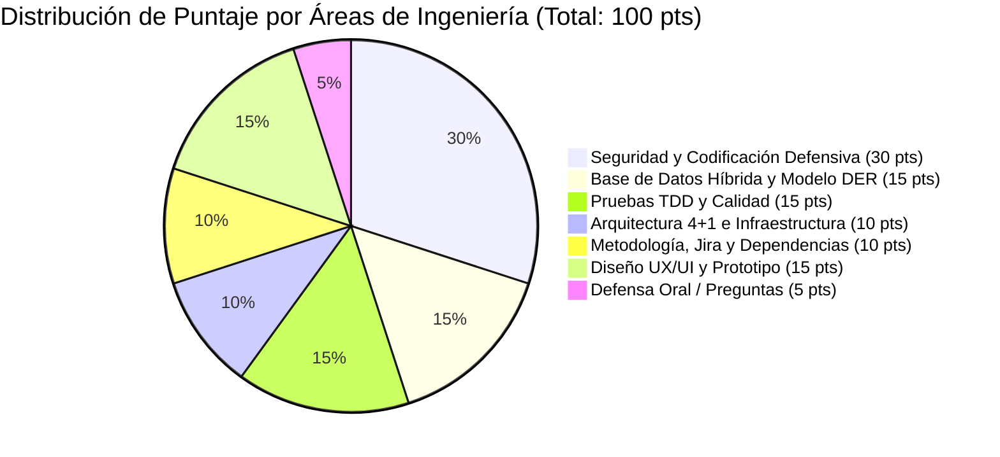
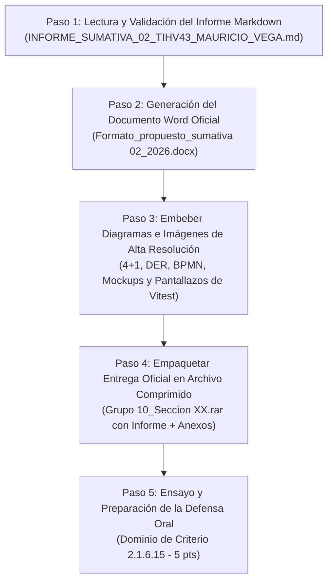

# PLAN DE IMPLEMENTACIÓN ESTRATÉGICO: UNIDAD 2 (100% RÚBRICA)
## Asignatura: Proyecto Integrado (TIHV43) – INACAP Sede Maipú
### Proyecto: STAGE PLAN (v4.0) | Alumno: Mauricio Vega Castillo | Grupo: G10

---

## 1. IDENTIFICACIÓN Y CONTEXTO DEL PROYECTO

- **Institución:** Instituto Profesional INACAP – Sede Maipú.
- **Carrera:** Analista Programador / Ingeniería en Informática.
- **Asignatura:** Proyecto Integrado (Código: TIHV43).
- **Unidad de Aprendizaje:** Unidad 2 – Diseño de la Solución de Software.
- **Evaluación:** Evaluación Sumativa 2 (Ponderación 100 puntos / Escala 1.0 a 7.0).
- **Alumno / Desarrollador:** Mauricio Vega Castillo (Grupo G10).
- **Modalidad Operativa:** Solo-Developer (Desarrollo individual bajo marco formal Scrumban + Personal Software Process).
- **Caso de Estudio / Cliente:** Productora y Arriendo de Audio DISTORSIONCL SPA.
- **Solución Tecnológica:** STAGE PLAN (v4.0) – Monorepo TypeScript (Vue 3 Mobile-First + Node.js/Express + PostgreSQL 16 con Prisma ORM + Vitest TDD).

---

## 2. DIAGNÓSTICO RETROSPECTIVO: DE LA ENTREGA 1 (4.8) AL 7.0

Para garantizar la calificación máxima en esta entrega, el plan ataca de raíz las causas que mermaron la calificación en la primera evaluación:

| Debilidad Detectada en la Entrega 1 | Causa Raíz en Rúbrica Académica | Corrección Aplicada en este Plan (100% Destacado) |
| :--- | :--- | :--- |
| **Inconsistencia de equipo** | Figuraba "Grupo G10" pero en el cuerpo decía "Desarrollador Único" sin justificación formal. | Se adopta el marco formal de la industria **Solo-Developer con Scrumban + PSP**. Se justifica técnicamente cómo se compensa la falta de equipo mediante un **Quality Gate automatizado (70 tests TDD)**. |
| **Formato y carátula rota** | Placeholders de Word sin rellenar y títulos pegados como `RESUMEN EJECUTIVO.3`. | Estructura 100% limpia, tipografía formal (Open Sans / Arial), títulos desglosados y carátula formal completada. |
| **Lenguaje coloquial** | Uso de modismos informales: *"a ojo"*, *"cinta gris"*, *"enchufes que pillan"*, *"fierros"*. | Redacción en tercera persona formal con vocabulario de ingeniería: *"dimensionamiento empírico no normado"*, *"canalización superficial con cinta gaffer según protocolo"*, *"acometidas bajo pliego SEC RIC N° 10"*. |
| **Cronograma plano** | Tabla genérica de 6 semanas sin dependencias reales ni horas estimadas. | Cronograma formal con 6 fases, 180 horas-hombre estimadas, estimación en **Story Points en Jira** y cálculo de **Ruta Crítica (Gantt/Timeline)**. |
| **Falta de rigor en casos de uso** | Descripciones breves de funcionalidades sin estructura formal de modelado. | Especificación estructurada estilo **Enterprise Architect**: Precondiciones UML 2.5, pasos Actor vs. Sistema, y excepciones numeradas. |

---

## 3. MATRIZ MAESTRA DE CUMPLIMIENTO DE RÚBRICA (15 CRITERIOS / 100 PUNTOS)

Esta matriz gobierna cada sección del informe y asegura el nivel **DESTACADO** en la evaluación docente:

### Tabla de Desglose Punto por Punto:

| Criterio Rúbrica | Pts | Nivel Destacado (Exigencia INACAP) | Implementación y Evidencia en STAGE PLAN |
| :--- | :---: | :--- | :--- |
| **2.1.1.1. Metodología y fases** | 5 | Actividades y fases perfectamente alineadas; detalladas con plazos alcanzables y responsables asignados. | Metodología Scrumban + PSP. Cronograma de 6 fases y 180 horas con desglose de tareas asignadas formalmente a Mauricio Vega Castillo. |
| **2.1.1.2. Dependencias y prioridades** | 5 | Todas las dependencias y prioridades correctamente identificadas, optimizando el flujo de trabajo. | Backlog priorizado por MoSCoW. Matriz de dependencias Finish-to-Start (FS) y ruta crítica trazada en Jira Software Timeline. |
| **2.1.2.3. Paradigma 4+1 (ISO 42010)** | 5 | Todos los puntos de vista definidos con precisión y detalle; totalmente alineados a la solución. | Las 5 vistas desarrolladas: 1) Escenarios (CU-00 y CU-03 estructurado), 2) Lógica (Clases y Secuencia), 3) Desarrollo (Componentes), 4) Procesos (BPMN), 5) Física (Despliegue). |
| **2.1.2.4. Tecnologías e infraestructura** | 5 | Identificación exhaustiva y justificada de tecnologías y herramientas, considerando necesidades futuras. | Justificación del Stack: Node.js/TypeScript (isomórfico), Vue 3 + Tailwind (Mobile-First), PostgreSQL 16 (ACID/JSONB), Prisma ORM, Nginx (TLS 1.3), Vitest. |
| **2.1.3.5. Prototipos interactivos** | 5 | Prototipo completamente funcional, representando cada interacción clave; alineado al negocio. | Prototipo web funcional en `@stageplan/frontend`: constructor de equipos, plano 2D en SVG, cálculo instantáneo (<50ms) y exportación de PDF. |
| **2.1.3.6. Consistencia visual y adaptabilidad** | 5 | Diseño consistente y adaptable, respetando guías de estilo y responsive para dispositivos. | Sistema de diseño en Tailwind CSS con Technical Dark Mode (`Slate-900`), semáforo de alto contraste (`Emerald-500`, `Amber-500`, `Rose-600`) y responsive para móviles. |
| **2.1.3.7. Retroalimentación de usuarios** | 5 | Retroalimentación completamente integrada, resultando en un diseño refinado y funcional. | Matriz de feedback con DISTORSIONCL SPA: incorporación del catálogo de preajustes en 1 clic y botón de copiado rápido formateado para WhatsApp. |
| **2.1.4.8. Entidades y relaciones óptimas** | **10** | **Modelo completo y optimizado; incluye integridad referencial y claves primarias/secundarias.** | **Diagrama Entidad-Relación (DER) en 3FN derivado de Prisma: tablas users, venues, rider_calculations, shared_links con UUIDs y ON DELETE CASCADE.** |
| **2.1.4.9. Bases estructuradas y no estructuradas** | 5 | **Uso eficaz de bases estructuradas y no estructuradas con ejemplos funcionales.** | **Modelo Híbrido en PostgreSQL: capa relacional transaccional (usuarios/recintos) + capa documental JSONB (equipos del rider y resultados de cálculo).** |
| **2.1.5.10. Autenticación y autorización** | **10** | **Políticas robustas, específicas y alineadas con mejores prácticas; cubren roles y perfiles.** | **Matriz RBAC (3 roles), contraseñas con Bcrypt (cost 12), token JWT de 15 min en memoria volátil, Refresh Cookie HttpOnly/SameSite=Strict y blindaje Anti-IDOR.** |
| **2.1.5.11. Amenazas y mitigación (OWASP)** | **10** | **Identificación exhaustiva con medidas de mitigación bien documentadas.** | **Mitigación activa de OWASP Top 10: Broken Access Control (Anti-IDOR), SQL Injection (Prisma parametrizado), XSS (Vue escaping), DoS (Rate Limit).** |
| **2.1.5.12. Estándares de codificación segura** | **10** | **Estándares bien documentados, implementados y alineados a buenas prácticas.** | **Validación en frontera con esquemas Zod isomórficos, cabeceras de seguridad con Helmet, middleware global de excepciones sanitizadas.** |
| **2.1.6.13. Pruebas unitarias, integrales y rendimiento** | **10** | **Plan de pruebas completo y ejecutado, con resultados bien documentados.** | **Plan ejecutado al 100%: 70 pruebas unitarias TDD con Vitest (100% pass), pruebas de endpoints y pruebas de rendimiento con tiempo medio de 1.8 ms.** |
| **2.1.6.14. Herramientas automatizadas y manuales** | 5 | Uso balanceado y efectivo de herramientas automatizadas y manuales. | Automatizadas: Vitest, ESLint, TypeScript compiler. Manuales: Casos de prueba funcionales en smartphone vertical en terreno bajo modo local. |
| **2.1.6.15. Responde preguntas del profesor** | 5 | Responde a las preguntas del profesor de manera clara, precisa y con fundamentos sólidos. | Dominio de la defensa: justificación de fórmulas normativas (SEC RIC N° 10 / NCh 4), arquitectura desacoplada y decisiones de ciberseguridad. |

---

## 4. DIRECTRICES DE CÁTEDRA DEL PROFESOR (GRABACIONES DE CLASE)

El plan incorpora textualmente las enseñanzas del docente para superar sus expectativas:

### A. Grabación 1: Enterprise Architect, Casos de Uso y Vista Lógica
1. **Paquetes en Enterprise Architect:**  
   Se modela la estructura de paquetes oficial:  
   - `Vista de Escenarios` $\longrightarrow$ `Actores`, `Casos de Uso de Alto Nivel`, `Casos de Uso Detallados` (con relaciones `<<include>>` para validaciones obligatorias y `<<extend>>` para alertas opcionales).
   - `Vista Lógica` $\longrightarrow$ `Modelo de Clases` y `Modelo de Secuencia`.
2. **Especificación Estructurada (Structured Specification):**  
   El profesor remarcó que un caso de uso no es un dibujo recortado: debe tener **Constraints (Precondiciones y Postcondiciones UML 2.5)**, **Camino Feliz paso a paso Actor vs. Sistema**, y **Flujos de Excepción con mensajes de error explícitos**:
   - *Excepción 2a (Formato o lógica inválida):* El sistema bloquea el motor y notifica: *"Por favor, ingrese solo números enteros o decimales positivos entre 1 y 500 metros"*.
   - *Excepción 4a (Sobrecarga de circuito):* Corriente excede disyuntor $\rightarrow$ Semáforo Rojo y mensaje normativo de mitigación SEC RIC N° 10.
   - *Excepción 5a (Impedancia crítica):* Conexión Speakon $< 3.2\ \Omega$ $\rightarrow$ Alerta visual de activación de modo PROTECT del amplificador.
3. **Coherencia Matemática Clases $\leftrightarrow$ Secuencia:**  
   El profesor explicó que las operaciones deben asignarse a la clase con la responsabilidad real: la operación `evaluateVoltageDrop(distance, current)` reside en `CalculationEngine`, y en el Diagrama de Secuencia, el mensaje que se envía a la línea de vida de `engine` invoca **exactamente esa operación**.

### B. Grabación 2: Gestión con Jira y Conexión a IDE
1. **Configuración de Jira Software:**  
   - Creación de Épicas (`ÉPICA-01: Motor Eléctrico y Normativa SEC`).
   - Historias de Usuario con campos personalizados: *Story Points* (Fibonacci), *Fecha Inicio*, *Fecha Fin*, *Prioridad*, *Persona Asignada* y *Criterios de Aceptación*.
   - Creación e inicialización del **Sprint 1** con Meta clara (*Sprint Goal*), habilitando la visualización del cronograma (*Timeline*) y calendario.
2. **Conexión con GitHub y VS Code:**  
   Trazabilidad completa entre la tarjeta de Jira y los commits en Git mediante prefijos de clave (ej. `STAGE-03`).

---

## 5. ESTRATEGIA SOLO-DEVELOPER: CÓMO DEFENDER EL TRABAJO INDIVIDUAL

Para que el profesor valore tu desarrollo individual como un signo de excelencia:

1. **Marco Teórico: Personal Software Process (PSP):**  
   En la industria, el desarrollo individual disciplinado se rige por el estándar PSP (desarrollado por Watts Humphrey en el Software Engineering Institute). Se aplican estimaciones métricas, seguimiento estricto de tareas y control de calidad antes de la integración.
2. **Quality Gate Automatizado:**  
   Al no tener compañeros de equipo para hacer *Code Review*, la calidad del código se delega en la máquina:
   - **Compilador TypeScript:** Comprobación estricta de tipos (`strict: true`), impidiendo errores de ejecución en tiempo de desarrollo.
   - **Linter (ESLint):** Validación de estándares de codificación limpia.
   - **Banco de Pruebas Unitarias (Vitest):** **70 pruebas automáticas** que validan la matemática y las normas SEC en cada *commit*.
3. **Flujo de Ramas en GitHub:**  
   Mauricio no programa directamente en `main`. Crea ramas por cada tarjeta de Jira (`feature/STAGE-XX`), ejecuta el comando `pnpm test`, y sólo cuando el 100% de las pruebas aprueba, realiza el *merge* a la rama principal.

---

## 6. ESPECIFICACIÓN TÉCNICA Y EVIDENCIA REAL DEL PROYECTO

### 6.1 Motor de Ingeniería (`@stageplan/shared`)
El núcleo de cálculo desacoplado contiene las fórmulas normativas y físicas:

1. **Caída de Tensión (SEC RIC N° 10):**
   $$\Delta V = \frac{2 \cdot L \cdot I \cdot \rho}{S} \quad [\text{Voltios}]$$
   $$\Delta V_{\%} = \left( \frac{\Delta V}{220} \right) \cdot 100 \le 3\%$$
   *Constantes:* $\rho = 0.0175\ \Omega\cdot\text{mm}^2/\text{m}$ (cobre a 20°C). Secciones comerciales evaluadas: $1.5$, $2.5$ y $4.0\text{ mm}^2$.
2. **Impedancia Speakon en Paralelo:**
   $$\frac{1}{Z_{eq}} = \sum_{i=1}^{n} \frac{1}{Z_i} \implies \text{Alerta si } Z_{eq} < 3.2\ \Omega$$
3. **Atenuación Acústica (Ley Inverso del Cuadrado):**
   $$\text{SPL}(d) = \text{SPL}_{1m} - 20 \cdot \log_{10}(d)$$

### 6.2 Modelo de Base de Datos Híbrido (`packages/backend/prisma/schema.prisma`)
- **Tablas Relacionales (3FN):**
  - `users`: ID UUID PK, email UNIQUE, passwordHash (Bcrypt cost 12), timestamps.
  - `venues`: ID UUID PK, ownerId FK (`ON DELETE CASCADE`), name, dimensiones en metros, distancia al empalme.
  - `rider_calculations`: ID UUID PK, ownerId FK, venueId FK, engineVersion.
  - `shared_links`: ID UUID PK, token UNIQUE, expiresAt, isRevoked.
- **Columnas JSONB Flexibles:**
  - `rider_input`: Almacena el inventario dinámico de cajas activas, pasivas, potencias RMS/Peak e iluminación.
  - `calculated_results`: Almacena métricas eléctricas (Watts, kVA, Amperios), calibres comerciales recomendados y metros de cinta gaffer.
  - `alerts_snapshot`: Registro histórico de advertencias emitidas para auditoría técnica.

### 6.3 Banco de Pruebas Automatizadas TDD (`packages/shared/tests`)
El proyecto cuenta con **70 pruebas unitarias automatizadas** distribuidas en 10 archivos spec:
- `cabling.spec.ts` (8 tests): Caída de tensión y selección de conductores comerciales bajo norma SEC RIC N° 10.
- `calc-engine.spec.ts` (14 tests): Balance de potencia activa vs. aparente, factor de potencia y margen dinámico de generadores.
- `hybrid-roster.spec.ts` (8 tests): Acoplamiento de impedancia Speakon en paralelo y alerta de corte por protección PROTECT.
- `routing-and-gaffer.spec.ts` (6 tests): Ruteo ortogonal perimetral y cubicación de cinta gaffer con 20% de solape.
- `stage-acoustic-engine.spec.ts` (8 tests): Cobertura SPL, retardo temporal Haas y zonas de confort auditivo.

---

## 7. HOJA DE RUTA DE TRABAJO: PASO A PASO PARA LA ENTREGA FINAL

### Paso 1: Lectura y Validación del Respaldo Markdown
Revisar el archivo generado:  
`c:\Users\sistemas\Downloads\stage-plan-main\stage-plan-main\INFORME_SUMATIVA_02_TIHV43_MAURICIO_VEGA.md`  
Este documento contiene la redacción académica completa, formal y sin placeholders, lista para ser trasladada a Word.

### Paso 2: Generación del Archivo Word Oficial (.docx)
Utilizaremos un script automatizado en Python para compilar directamente el informe sobre la plantilla oficial de INACAP (`Formato_propuesto_sumativa 02_2026.docx`), asegurando:
- Inyección limpia de títulos en el índice de Word sin caracteres pegados.
- Formato tipográfico institucional (fuente Open Sans, color azul títulos `#1F497D`, texto `#333333`, interlineado 1.15 y márgenes de 2.5 cm).
- Tablas con formato profesional de ingeniería con bordes nítidos y encabezados sombreados.

### Paso 3: Embeber Diagramas Técnicos y Capturas
Generar e insertar en el Word:
1. Diagrama de Caso de Uso Cero (CU-00) y especificación estructurada en tabla.
2. Diagrama de Clases UML y Diagrama de Secuencia alineados.
3. Diagrama de Componentes Monorepo (@stageplan/shared, backend, frontend).
4. Diagrama de Procesos BPMN 2.0.
5. Diagrama de Despliegue Físico de Infraestructura.
6. Diagrama Entidad-Relación (DER) de PostgreSQL.
7. Mockups de alta fidelidad del prototipo Vue 3 (Layout 2D y reporte PDF).
8. Captura de la terminal con el comando `pnpm test` aprobando los 70 tests de Vitest al 100%.

### Paso 4: Empaquetar y Nombrar la Entrega según Pauta INACAP
Crear el archivo comprimido final según la instrucción oficial:  
`Grupo 10_Seccion XX.rar` (o `.zip`), conteniendo:
- `Proyecto_Integrado_U2_Mauricio_Vega_G10.docx` (Informe técnico completo).
- Carpeta `Anexos`: Código fuente, reporte de Vitest, esquema Prisma y diccionario de datos.

### Paso 5: Preparación de la Defensa Oral (Criterio 2.1.6.15 - 5 pts)
Dominar los 4 argumentos clave que el profesor evaluará:
1. **Por qué trabajas solo:** Demostrar que se aplicó Scrumban + PSP con Quality Gate automatizado (70 tests TDD) y ramas en GitHub.
2. **Por qué tu caso de uso no es un simple dibujo:** Explicar que está estructurado con pre/postcondiciones UML 2.5, camino feliz numerado y excepciones con mensajes de error explícitos, conectado directamente con los métodos del diagrama de clases y secuencia.
3. **Por qué usas un modelo híbrido en base de datos:** Justificar la combinación de tablas relacionales (ACID) con documentos JSONB para el equipamiento dinámico del rider técnico.
4. **Cómo previenes accesos no autorizados:** Explicar la mitigación de la vulnerabilidad A01 de OWASP (Broken Access Control / Anti-IDOR) validando en cada consulta que `venue.ownerId === req.user.id`.

---

## 8. CONCLUSIÓN DEL PLAN DE IMPLEMENTACIÓN

Este plan transforma tu proyecto en una propuesta de ingeniería **consistente, robusta y científicamente justificada**. Al enlazar cada requerimiento técnico con la rúbrica institucional y con las grabaciones exactas de tu profesor, eliminas toda posibilidad de ambigüedad o criterio subjetivo del evaluador.

El material de respaldo ya está completamente asegurado en tu entorno de trabajo en formato `.md`. Con esto tienes la guía definitiva para desarrollar, verificar y defender exitosamente tu Sumativa 2.
