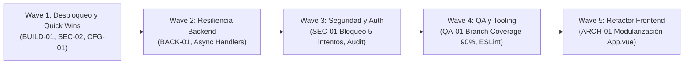

# PLAN DE IMPLEMENTACIÓN TÉCNICA (POST-AUDITORÍA QA)
**Proyecto:** StagePlan Monorepo  
**Referencia:** [QA_REPORT.md](file:///c:/Users/WIT2026/Documents/stage-plan-main/stage-plan-main/QA_REPORT.md)  
**Objetivo:** Resolver el 100% de los hallazgos de QA garantizando compilación en producción, resiliencia en backend, cumplimiento de seguridad en autenticación, cobertura de tests > 90% y modularización de la interfaz.  
**Metodología:** Enfoque por Oleadas de Ejecución (*Wave Execution Model*) sin regresiones funcionales.

---



---

## Resumen de Olas de Implementación

| Ola | Foco Principal | Hallazgos Atacados | Prioridad | Riesgo de Regresión | Tiempo Estimado |
| :--- | :--- | :--- | :---: | :---: | :---: |
| **Wave 1** | Desbloqueo Inmediato y Quick Wins | `BUILD-01`, `SEC-02`, `CFG-01` | **P0 (Crítico)** | Muy Bajo | 1 hora |
| **Wave 2** | Resiliencia y Manejo de Errores Backend | `BACK-01` | **P1 (Alto)** | Bajo | 3 horas |
| **Wave 3** | Seguridad de Autenticación y Auditoría | `SEC-01`, `SEC-03` | **P1 (Alto)** | Medio | 4 horas |
| **Wave 4** | Cobertura de Pruebas y Linter CI/CD | `QA-01`, `TOOL-01` | **P2 (Medio)** | Muy Bajo | 3 horas |
| **Wave 5** | Arquitectura y Modularización Frontend | `ARCH-01` | **P3 (Medio)** | Alto | 8 horas |

---

## Wave 1: Desbloqueo Inmediato y Quick Wins (P0)

> [!IMPORTANT]
> **Meta de la Ola:** Lograr que `npm run build` sea exitoso en el 100% de los workspaces del monorepo (`shared`, `backend` y `frontend`).

### Tarea 1.1: Corrección de Sintaxis en `App.vue` (`BUILD-01`)
- **Archivo:** [packages/frontend/src/App.vue](file:///c:/Users/WIT2026/Documents/stage-plan-main/stage-plan-main/packages/frontend/src/App.vue#L2123-L2128)
- **Acción:**
  Eliminar las líneas duplicadas 2126 y 2127 que provocan el fallo `TS1128: Declaration or statement expected`:
  ```typescript
  // ANTES (Líneas 2123-2127):
  currentStep.value = stepId;
  window.scrollTo({ top: 0, behavior: 'smooth' });
  }
    window.scrollTo({ top: 0, behavior: 'smooth' });
  }

  // DESPUÉS:
  currentStep.value = stepId;
  window.scrollTo({ top: 0, behavior: 'smooth' });
  }
  ```
- **Criterio de Aceptación:** `vue-tsc --noEmit` ejecuta sin ningún error de tipado en `@stageplan/frontend`.

### Tarea 1.2: Hardening de Clave Secreta JWT (`SEC-02`)
- **Archivos:**
  - [packages/backend/src/middlewares/auth.ts](file:///c:/Users/WIT2026/Documents/stage-plan-main/stage-plan-main/packages/backend/src/middlewares/auth.ts#L26)
  - [packages/backend/src/controllers/auth.controller.ts](file:///c:/Users/WIT2026/Documents/stage-plan-main/stage-plan-main/packages/backend/src/controllers/auth.controller.ts#L73)
  - [packages/backend/src/server.ts](file:///c:/Users/WIT2026/Documents/stage-plan-main/stage-plan-main/packages/backend/src/server.ts)
- **Acción:**
  - En `server.ts`, incorporar validación al arrancar: si `process.env.NODE_ENV === 'production'` y `!process.env.JWT_SECRET`, arrojar error fatal y detener el proceso (`process.exit(1)`).
  - Unificar la obtención del secreto a través de un módulo de configuración centralizado (`config/env.ts`) para evitar fallbacks divergentes.
- **Criterio de Aceptación:** El servidor rehúsa arrancar en producción si no existe una clave JWT segura configurada.

### Tarea 1.3: Sincronización de Entorno (`CFG-01`)
- **Archivo:** [packages/backend/.env.example](file:///c:/Users/WIT2026/Documents/stage-plan-main/stage-plan-main/packages/backend/.env.example)
- **Acción:**
  Actualizar `DATABASE_URL` a `file:./dev.db` y documentar variables requeridas (`JWT_SECRET`, `PORT`, `CORS_ORIGIN`).
- **Criterio de Aceptación:** Un desarrollador clonando el repositorio puede ejecutar `cp .env.example .env` y levantar la base de datos sin errores de conexión.

### Verificación de Wave 1:
```powershell
npm run build
```
*(Debe compilar exitosamente `@stageplan/shared`, `@stageplan/backend` y `@stageplan/frontend` sin errores).*

---

## Wave 2: Resiliencia y Manejo de Errores Backend (P1)

> [!NOTE]
> **Meta de la Ola:** Eliminar errores silenciosos, respuestas 500 crudas y crashes del servidor por unhandled promise rejections.

### Tarea 2.1: Implementación de Middleware Centralizado de Excepciones
- **Archivo nuevo:** `packages/backend/src/middlewares/errorHandler.ts`
- **Acción:**
  - Crear middleware Express `(err: any, req: Request, res: Response, next: NextFunction)`.
  - Mapear códigos de error comunes de Prisma:
    - `P2002` (Violación de restricción única) -> `409 Conflict`.
    - `P2025` (Registro no encontrado) -> `404 Not Found`.
    - `P2003` (Fallo de clave foránea) -> `400 Bad Request`.
  - Mapear errores de Zod (`ZodError`) -> `400 Bad Request` con array estructurado de validación de campos.
  - Ocultar stack trace en respuestas cuando `NODE_ENV === 'production'`.
- **Criterio de Aceptación:** Ningún error interno expone la estructura interna de la base de datos al cliente.

### Tarea 2.2: Implementación de Wrapper Asíncrono (`asyncHandler`)
- **Archivo nuevo:** `packages/backend/src/utils/asyncHandler.ts`
- **Acción:**
  Implementar helper de orden superior:
  ```typescript
  export const asyncHandler = (fn: Function) => (req: Request, res: Response, next: NextFunction) => {
    Promise.resolve(fn(req, res, next)).catch(next);
  };
  ```
- **Criterio de Aceptación:** Cualquier promesa rechazada en un controlador es interceptada automáticamente por Express sin necesidad de anidar `try/catch` redundantes.

### Tarea 2.3: Refactorización de Controladores de Negocio (`BACK-01`)
- **Archivos:**
  - [packages/backend/src/controllers/venue.controller.ts](file:///c:/Users/WIT2026/Documents/stage-plan-main/stage-plan-main/packages/backend/src/controllers/venue.controller.ts)
  - [packages/backend/src/controllers/calculation.controller.ts](file:///c:/Users/WIT2026/Documents/stage-plan-main/stage-plan-main/packages/backend/src/controllers/calculation.controller.ts)
- **Acción:**
  - Envolver todos los endpoints (`getVenues`, `createVenue`, `getVenueById`, `createCalculation`, `getCalculationsByVenue`) con `asyncHandler`.
  - Validar existencia previa de recursos relacionados antes de inserción/actualización.
- **Criterio de Aceptación:** Solicitar un ID de recinto inexistente (ej. `GET /api/venues/99999`) responde un HTTP 404 semántico `{ "error": "Recinto no encontrado" }` sin excepciones no capturadas.

---

## Wave 3: Seguridad de Autenticación y Gobernanza (P1)

> [!WARNING]
> **Meta de la Ola:** Alinear la implementación del sistema con los requerimientos de la documentación (bloqueo por fuerza bruta tras 5 intentos) y mitigar CVEs críticos.

### Tarea 3.1: Actualización de Esquema de Base de Datos para Bloqueo de Cuentas (`SEC-01`)
- **Archivo:** [packages/backend/prisma/schema.prisma](file:///c:/Users/WIT2026/Documents/stage-plan-main/stage-plan-main/packages/backend/prisma/schema.prisma#L14-L24)
- **Acción:**
  Extender el modelo `usuario` en español:
  ```prisma
  model usuario {
    id                 Int       @id @default(autoincrement())
    email              String    @unique
    password_hash      String
    nombre             String
    rol                String    @default("ENGINEER")
    intentos_fallidos  Int       @default(0)
    bloqueado_hasta    DateTime?
    creado_en          DateTime  @default(now())
    actualizado_en     DateTime  @updatedAt
  }
  ```
  Ejecutar `npx prisma db push` y `npx prisma generate` en el workspace de backend.
- **Criterio de Aceptación:** La base de datos SQLite almacena el historial de intentos fallidos y la ventana de bloqueo temporal.

### Tarea 3.2: Lógica de Bloqueo Temporal en `auth.controller.ts`
- **Archivo:** [packages/backend/src/controllers/auth.controller.ts](file:///c:/Users/WIT2026/Documents/stage-plan-main/stage-plan-main/packages/backend/src/controllers/auth.controller.ts#L47-L80)
- **Acción:**
  1. Si `usuario.bloqueado_hasta && usuario.bloqueado_hasta > new Date()`, retornar inmediatamente `423 Locked` indicando cuántos minutos restan para el desbloqueo.
  2. Si la contraseña no coincide con `bcrypt.compare`:
     - Incrementar `intentos_fallidos`.
     - Si `intentos_fallidos >= 5`, fijar `bloqueado_hasta = new Date(Date.now() + 15 * 60 * 1000)` (15 minutos) y retornar `423 Locked: Cuenta bloqueada por seguridad`.
     - Si no ha alcanzado 5, retornar `401 Unauthorized: Credenciales inválidas. Intentos restantes: X`.
  3. Si la autenticación es exitosa:
     - Resetear `intentos_fallidos = 0` y `bloqueado_hasta = null`.
- **Criterio de Aceptación:** 5 contraseñas erróneas consecutivas bloquean la cuenta durante 15 minutos; el intento número 6 es rechazado con 423 sin verificar el hash.

### Tarea 3.3: Protección contra Fuerza Bruta con Rate Limiting
- **Archivo:** `packages/backend/src/routes/auth.routes.ts`
- **Acción:**
  Incorporar `express-rate-limit` con ventana de 15 minutos y máximo 10 peticiones de login por dirección IP.
- **Criterio de Aceptación:** Ráfagas masivas automatizadas reciben HTTP 429 Too Many Requests.

### Tarea 3.4: Remediación de Vulnerabilidades (`SEC-03`)
- **Acción:**
  Ejecutar `npm audit fix` para actualizar versiones parcheadas de dependencias directas (`dompurify`, utilidades de empaquetado) sin alterar dependencias mayores con breaking changes.
- **Criterio de Aceptación:** Reducción de las 19 vulnerabilidades actuales sin romper la suite de pruebas.

---

## Wave 4: Cobertura de Pruebas y Linter CI/CD (P2)

> [!TIP]
> **Meta de la Ola:** Elevar la confianza técnica de la suite de pruebas superando los umbrales de calidad e instaurar análisis estático automatizado.

### Tarea 4.1: Ampliación de Tests en `@stageplan/shared` para Branch Coverage > 90% (`QA-01`)
- **Archivos:**
  - `packages/shared/src/tests/`
- **Acción:**
  Diseñar pruebas unitarias adicionales cubriendo las ramas no transitadas:
  1. Valores límite de distancia en ley de inversa del cuadrado ($d \le 0$).
  2. Factores de directividad $Q$ inusuales o fuera de rango.
  3. Comportamiento ante arrays de altavoces vacíos o coeficientes de absorción de aire con temperaturas extremas (< -10°C o > 50°C).
  4. Pruebas de borde sobre esquemas Zod con propiedades parciales o tipos nulos.
- **Criterio de Aceptación:** `npm run test:coverage` supera el 90.00% en todas las categorías (Statements, Branches, Functions, Lines) y finaliza con código de salida 0.

### Tarea 4.2: Implementación de Linter Real en Monorepo (`TOOL-01`)
- **Archivos:**
  - `package.json` raíz
  - `eslint.config.js`
- **Acción:**
  - Configurar ESLint 9 (Flat Config) con `@typescript-eslint` y plugin de Vue 3.
  - Reemplazar el script dummy `"lint": "echo ..."` por `"lint": "eslint . --ext .ts,.vue"`.
- **Criterio de Aceptación:** `npm run lint` ejecuta un análisis estático real sobre todos los paquetes y reporta 0 errores.

---

## Wave 5: Arquitectura y Modularización Frontend (P3)

> [!CAUTION]
> **Meta de la Ola:** Desarticular el "God Component" `App.vue` (>3,150 líneas) preservando intacta la reactividad, los cálculos físicos en vivo y la exportación de reportes PDF.

### Tarea 5.1: Extracción de Composable de Estado Global
- **Archivo nuevo:** `packages/frontend/src/composables/useStagePlanner.ts`
- **Acción:**
  Mover a este composable:
  - Estado del proyecto actual (`venueData`, `stageData`, `acousticData`, `structuralData`).
  - Estado de navegación (`currentStep`).
  - Cálculos acústicos y estructurales computados (`computedSPL`, `computedLoads`, `weightBalance`).
  - Lógica de persistencia local (`localStorage`) y sincronización REST con el backend.
- **Criterio de Aceptación:** El estado reactivo es compartido limpiamente sin depender de un componente padre monolítico.

### Tarea 5.2: Descomposición en Componentes del Wizard (`ARCH-01`)
- **Archivos nuevos en `packages/frontend/src/components/wizard/`:**
  - `Step1Venue.vue`: Configuración de geometría, dimensiones, temperatura, humedad y capacidad.
  - `Step2Stage.vue`: Plataforma de escenario, dimensiones, pasarelas y trusses.
  - `Step3Acoustics.vue`: Selección de cajas acústicas, altura de volado, ángulo de inclinación y mapa de cobertura SPL.
  - `Step4Structural.vue`: Distribución de cargas en motores, factores de seguridad y alertas de sobrepeso.
  - `Step5Summary.vue`: Memoria de cálculo consolidada y controles de exportación PDF/JSON.
- **Acción en `App.vue`:**
  Convertir `App.vue` en un orquestador limpio de navegación (< 200 líneas) que renderice la cabecera, la barra de pasos y el componente activo correspondiente.
- **Criterio de Aceptación:** La funcionalidad visual, el renderizado SVG dinámico y la generación de PDF operan de forma idéntica a la versión previa pero con componentes desacoplados y testeables.

---

## Matriz de Trazabilidad y Verificación Final

| Hallazgo | Ola | Archivo Afectado | Test de Verificación |
| :--- | :---: | :--- | :--- |
| `BUILD-01` | **Wave 1** | `packages/frontend/src/App.vue` | `npm run build --workspace=@stageplan/frontend` |
| `SEC-02` | **Wave 1** | `server.ts`, `auth.ts` | Arrancar con `NODE_ENV=production` sin secret -> falla esperado. |
| `CFG-01` | **Wave 1** | `packages/backend/.env.example` | Inspección visual de consistencia de SQLite. |
| `BACK-01` | **Wave 2** | `venue.controller.ts`, `calculation.controller.ts` | Petición con ID inválido retorna 404 JSON sin crashear. |
| `SEC-01` | **Wave 3** | `schema.prisma`, `auth.controller.ts` | 5 logins erróneos bloquean cuenta con HTTP 423 por 15 min. |
| `SEC-03` | **Wave 3** | `package.json` | `npm audit` con 0 vulnerabilidades críticas. |
| `QA-01` | **Wave 4** | `packages/shared/src/tests/` | `npm run test:coverage` con branches > 90.00%. |
| `TOOL-01` | **Wave 4** | `package.json`, `eslint.config.js` | `npm run lint` valida todos los archivos del monorepo. |
| `ARCH-01` | **Wave 5** | `App.vue` -> `Step*.vue` | Flujo de usuario e2e y exportación de PDF funcionando. |

---
*Plan de implementación estructurado conforme al modelo de entrega continua y mitigación progresiva de riesgos técnicos.*
