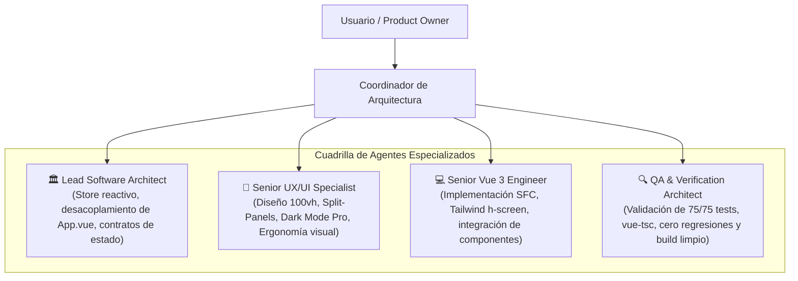
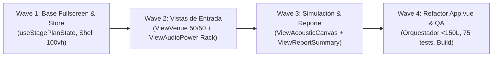

# PLAN DE IMPLEMENTACIÓN TÉCNICA: WORKSPACE FULLSCREEN NO-SCROLL (STUDIO ARCHITECTURE)
**Proyecto:** StagePlan Pro  
**Paradigma:** Fullscreen Engineering Cockpit (100vh / 100dvh — Cero Scroll de Ventana)  
**Objetivo:** Transformar la interfaz monolítica vertical en una suite de software profesional tipo CAD/DAW (similar a Soundvision, Figma o Ableton Live), donde cada paso del wizard es una vista dedicada a pantalla completa con paneles especializados.  
**Metodología:** Wave Execution Model (4 Oleadas sin regresión funcional ni rotura de cálculos).

---

## 1. Cuadrilla de Especialistas (Roster de Agentes)



| Rol / Agente | Responsabilidad Principal | Entregables Clave |
| :--- | :--- | :--- |
| **🏛️ Lead Software Architect** | Gobernanza de estado y modularización limpia | `src/composables/useStagePlanState.ts`, contratos de interfaces. |
| **🎨 Senior UX/UI Specialist** | Jerarquía visual, layout fullscreen y micro-interacciones | Wireframes de vistas, diseño de HUD de telemetría, split-screens 50/50. |
| **💻 Senior Vue 3 Engineer** | Codificación de componentes y vistas desacopladas | `ViewVenue.vue`, `ViewAudioPower.vue`, `ViewAcousticCanvas.vue`, `ViewReportSummary.vue`. |
| **🔍 QA & Verification Architect** | Pruebas de integración, tipado estricto y compilación | Validación `npm run lint`, `npm test` (75 tests), `npm run build` exitoso. |

---

## 2. Diagrama de Arquitectura del Workspace Fullscreen

```text
┌────────────────────────────────────────────────────────────────────────────────────────┐
│ [StudioHeader.vue - Fijo 56px]                                                        │
│ 🔴 STAGE PLAN PRO   |  [0 Auth]  [1 Recinto]  [2 Equipos]  [3 Simulación 2D]  [4 Reporte]  │
├────────────────────────────────────────────────────────────────────────────────────────┤
│                                                                                        │
│  [Área de Trabajo Central Dinámica: flex-1 min-h-0 overflow-hidden]                    │
│                                                                                        │
│  ┌───────────────────────────────────┬──────────────────────────────────────────────┐  │
│  │ Panel de Control Izquierdo        │ Panel Visualizador / Canvas Derecho          │  │
│  │ (380px - 450px)                   │ (Flex-1: Llena todo el espacio restante)     │  │
│  │                                   │                                              │  │
│  │ • Inputs numéricos y sliders      │ • Vista 1: Plano perimétrico 2D en vivo      │  │
│  │ • Selectores tipo rack modular    │ • Vista 2: Tacómetro de fase y carga eléctrica│  │
│  │ • (Scroll interno suave si la     │ • Vista 3: Lienzo CAD 2D interactivo         │  │
│  │    pantalla es menor a 800px)     │ • Vista 4: Tarjeta de camión y ficha técnica │  │
│  └───────────────────────────────────┴──────────────────────────────────────────────┘  │
│                                                                                        │
├────────────────────────────────────────────────────────────────────────────────────────┤
│ [StudioFooter.vue - Fijo 52px]                                                        │
│ ⚡ 2.450W RMS | 🔌 Línea 1: 11.1A | 🎯 102 dBA | 📦 185 kg   |   [← Atrás] [Siguiente →]│
└────────────────────────────────────────────────────────────────────────────────────────┘
```

---

## 3. Plan de Olas de Implementación (Waves)



---

### Wave 1: Cimientos del Workspace Fullscreen & Composable de Estado (P0)
**Líderes:** Lead Software Architect + Senior Vue 3 Engineer  
**Objetivo:** Construir el shell `100vh` sin scroll de ventana y centralizar el estado reactivo que actualmente vive atrapado en las 3,150 líneas de `App.vue`.

- **Tarea 1.1: Extracción del Composable de Estado Global (`useStagePlanState.ts`)**
  - Mover la reactividad de:
    - Datos del recinto (`venue`: ancho, largo, alto, tipo entorno, distancia eléctrica).
    - Roster de equipos de audio (`speakerBatches`, cálculo de tops y subs).
    - Estado de energía (`powerSource`: red 220V, generador kVA/Watts, breaker).
    - Datos de iluminación, DJ booth y contingencia.
    - Resultados computados en tiempo real (`stageAcousticResult`, `fieldAudit`, `loadLogistics`).
    - Paso activo (`currentStep`).
  - **Criterio de Aceptación:** Todas las vistas consumen y modifican el mismo estado sin requerir cadenas profundas de props ni eventos anidados.

- **Tarea 1.2: Shell Maestro Fullscreen (`h-screen w-screen overflow-hidden`)**
  - Configurar el contenedor raíz con flexbox vertical estricto:
    ```html
    <div class="h-screen w-screen overflow-hidden flex flex-col bg-[#0b0b0f] text-white select-none">
    ```

- **Tarea 1.3: Barra Superior Fija (`StudioHeader.vue`)**
  - Altura fija de 56px (`h-14 flex-none border-b border-zinc-800 bg-[#0f0f14]`).
  - Stepper visual moderno numerado del 1 al 4 con estado activo/completado/bloqueado.
  - Indicador de operador logueado y botón de cierre de sesión.

- **Tarea 1.4: Barra Inferior de Telemetría y Navegación (`StudioFooter.vue`)**
  - Altura fija de 52px (`h-[52px] flex-none border-t border-zinc-800 bg-[#0f0f14]`).
  - HUD de telemetría a la izquierda: Watts totales, corriente de fase, nivel SPL y peso total.
  - Botones de acción a la derecha: `← Anterior` y `Siguiente Paso →` (deshabilitado si hay validaciones pendientes).

---

### Wave 2: Vistas de Configuración en Modo Pantalla Dividida (P1)
**Líderes:** Senior UX/UI Specialist + Senior Vue 3 Engineer  
**Objetivo:** Reemplazar el scroll vertical del Paso 1 y Paso 2 por interfaces de pantalla completa divididas 50/50.

- **Tarea 2.1: Implementación de `ViewVenue.vue` (Paso 1: Medidas del Recinto)**
  - **Layout:** Contenedor `h-full grid grid-cols-1 lg:grid-cols-12 gap-4 p-4`.
  - **Columna Izquierda (5 cols):** Tarjeta con formulario ergonómico de medidas:
    - Sliders + inputs numéricos de sincronización bidireccional (Ancho, Largo, Alto).
    - Selector visual de tipo de pared (Hormigón, Galpón, Carpa, Aire Libre) con coeficientes acústicos automáticos.
    - Distancia a la fuente eléctrica y tipo de entorno.
    - Presets de 1 clic ("Club Subterráneo", "Galpón Industrial", "Parcela Abierta").
  - **Columna Derecha (7 cols):** Visualizador perimétrico 2D interactivo que se expande dinámicamente para ocupar el 100% de la altura disponible. Muestra cotas en metros y advertencias espaciales al instante.
  - **Criterio de Aceptación:** Modificar cualquier slider de medida actualiza el dibujo perimétrico a la derecha en menos de 16ms (60 FPS) sin ningún scroll de pantalla.

- **Tarea 2.2: Implementación de `ViewAudioPower.vue` (Paso 2: Equipos & Energía)**
  - **Layout:** Split de 3 columnas o 2 columnas con tabs tácticos.
  - **Columna Izquierda (Selector de Roster):** Selector tipo rack para añadir/modificar cajas acústicas (Tops, Subs, Monitores) en modo Activo / Pasivo.
  - **Columna Central (Lista de Equipos Activos):** Tarjetas compactas con especificaciones RMS, Peak e impedancia.
  - **Columna Derecha (HUD Eléctrico & Tacómetro):**
    - Gráfico de barras de carga eléctrica en vivo (Zona Verde < 80%, Amarilla 80-100%, Roja > 100%).
    - Recomendación de calibre de cable ($mm^2$) según RIC 03 / RIC 10.
  - **Criterio de Aceptación:** Cero scroll vertical. Todo el equipamiento y su impacto eléctrico se observan simultáneamente.

---

### Wave 3: Vistas de Simulación Inmersiva y Despacho Ejecutivo (P1)
**Líderes:** Senior UX/UI Specialist + Lead Software Architect  
**Objetivo:** Elevar el plano 2D y el reporte final a la categoría de software de nivel industrial.

- **Tarea 3.1: Implementación de `ViewAcousticCanvas.vue` (Paso 3: Plano 2D CAD)**
  - **Lienzo Central:** El componente [LayoutSvg2D.vue](file:///c:/Users/WIT2026/Documents/stage-plan-main/stage-plan-main/packages/frontend/src/components/LayoutSvg2D.vue) toma el 100% del área de trabajo disponible (`w-full h-full`).
  - **Barra de Herramientas Flotante (HUD Top):**
    - Controles de zoom in/out, fit-to-screen, cotas métricas y mapa de calor SPL on/off.
    - Botón para abrir el simulador de mixer DJ ([PioneerMixerSimulator.vue](file:///c:/Users/WIT2026/Documents/stage-plan-main/stage-plan-main/packages/frontend/src/components/PioneerMixerSimulator.vue)) como panel lateral deslizable o modal superpuesto (*Drawer / Overlay*), sin salir de la vista 2D.
  - **Criterio de Aceptación:** El plano técnico se siente como un visor CAD fluido y profesional.

- **Tarea 3.2: Implementación de `ViewReportSummary.vue` (Paso 4: Despacho & Memoria Técnica)**
  - **Dashboard Ejecutivo (Cero Scroll):**
    - 4 tarjetas superiores de KPIs de alta visibilidad (Potencia Total, SPL Audiencia, Peso de Carga, Horas Combustible).
    - Panel izquierdo: Ilustración del vehículo recomendado (SUV / Camioneta Pickup / Furgón Sprinter) y alerta ergonómica de la Ley N° 20.949 (Ley del Saco).
    - Panel central: Checklist operativo para retiro en bodega y montaje en terreno con casillas interactivas.
    - Panel derecho: Botón destacado de descarga de memoria de cálculo en PDF ([pdfReport.ts](file:///c:/Users/WIT2026/Documents/stage-plan-main/stage-plan-main/packages/frontend/src/services/pdfReport.ts)) y botón para copiar resumen a WhatsApp.
  - **Criterio de Aceptación:** El reporte se genera de forma instantánea y presenta toda la logística de un solo vistazo.

---

### Wave 4: Orquestación Final, Adelgazamiento de `App.vue` y QA (P0)
**Líderes:** QA & Verification Architect + Lead Software Architect  
**Objetivo:** Convertir `App.vue` en un orquestador minimalista (< 150 líneas) y garantizar cero regresiones en tests y build.

- **Tarea 4.1: Refactorización de `App.vue`**
  - Reemplazar las 3,150 líneas actuales por:
    ```html
    <template>
      <div class="h-screen w-screen overflow-hidden flex flex-col bg-[#0b0b0f] text-white">
        <StudioHeader />
        <main class="flex-1 min-h-0 overflow-hidden relative">
          <ViewAuth v-if="currentStep === 0" />
          <ViewVenue v-else-if="currentStep === 1" />
          <ViewAudioPower v-else-if="currentStep === 2" />
          <ViewAcousticCanvas v-else-if="currentStep === 3" />
          <ViewReportSummary v-else-if="currentStep === 4" />
        </main>
        <StudioFooter v-if="currentStep > 0" />
      </div>
    </template>
    ```

- **Tarea 4.2: Verificación de Pruebas y Compilación**
  - Ejecutar `npm run typecheck` / `npm run lint` en todos los workspaces.
  - Ejecutar `npm test` verificando los 75 tests unitarios de `@stageplan/shared`.
  - Ejecutar `npm run build` en `@stageplan/frontend` para garantizar compilación perfecta con Vite y `vue-tsc`.

---

## 4. Matriz de Entregables y Responsables

| Componente / Módulo | Ubicación | Agente Asignado |
| :--- | :--- | :--- |
| **Store Reactivo Global** | `packages/frontend/src/composables/useStagePlanState.ts` | 🏛️ Lead Architect |
| **Header Fijo con Stepper** | `packages/frontend/src/components/layout/StudioHeader.vue` | 🎨 Senior UX/UI |
| **Footer HUD y Navegación** | `packages/frontend/src/components/layout/StudioFooter.vue` | 🎨 Senior UX/UI |
| **Vista 0 (Auth Pro)** | `packages/frontend/src/views/ViewAuth.vue` | 💻 Frontend Engineer |
| **Vista 1 (Recinto Split 50/50)** | `packages/frontend/src/views/ViewVenue.vue` | 💻 Frontend Engineer |
| **Vista 2 (Audio & Energía)** | `packages/frontend/src/views/ViewAudioPower.vue` | 💻 Frontend Engineer |
| **Vista 3 (Canvas 2D CAD)** | `packages/frontend/src/views/ViewAcousticCanvas.vue` | 💻 Frontend Engineer |
| **Vista 4 (Despacho & Reporte)** | `packages/frontend/src/views/ViewReportSummary.vue` | 💻 Frontend Engineer |
| **Orquestador Principal** | `packages/frontend/src/App.vue` (< 150 líneas) | 🏛️ Lead Architect |
| **Auditoría de Calidad & Build**| Suites de pruebas y verificación de bundle | 🔍 QA Architect |

---

## 5. Criterios de Éxito Globales

1. 🚫 **Cero Scroll de Ventana:** La barra de desplazamiento del navegador (`window.scrollY`) permanece inactiva en todo momento; toda la experiencia vive dentro de la ventana del usuario (`100vh`).
2. ⚡ **Reactividad Instantánea (< 16ms):** Cualquier cambio de dimensiones o equipos en los paneles izquierdos actualiza los modelos 2D y la telemetría en tiempo real.
3. 📦 **Compilación de Producción Limpia:** `npm run build` genera el bundle sin errores ni advertencias de tipos en `vue-tsc`.
4. 🧪 **Integridad Matemática Absoluta:** Los 75 tests unitarios del motor físico continúan pasando al 100%.

---
*Plan de arquitectura y rediseño UI/UX estructurado conforme a los más altos estándares de diseño de software de ingeniería.*
